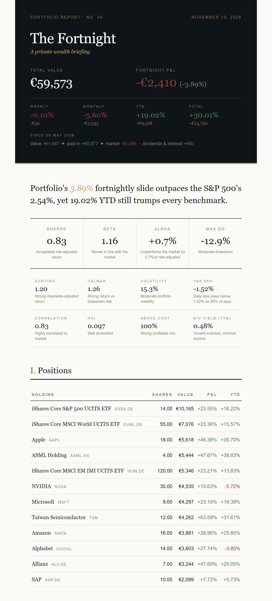
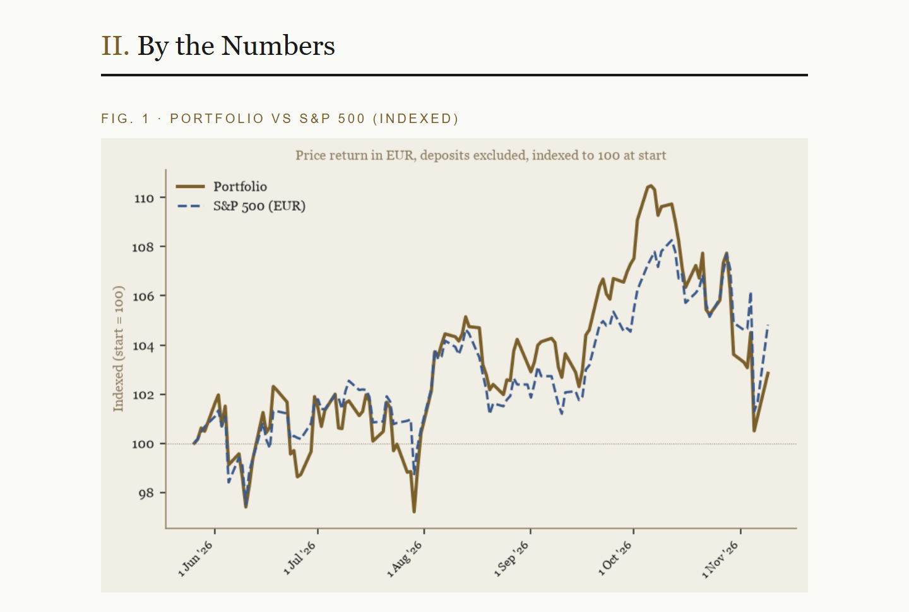
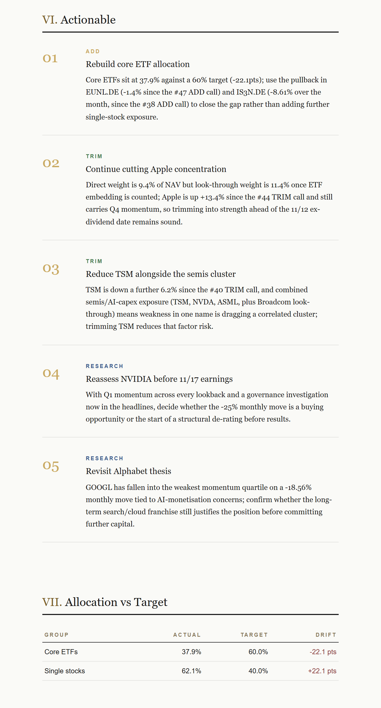
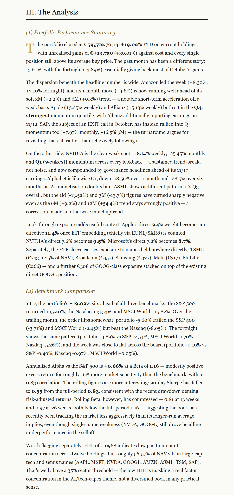
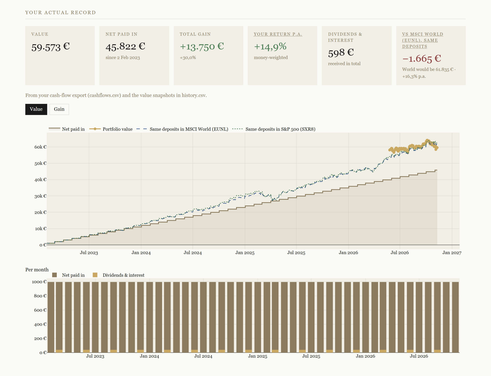
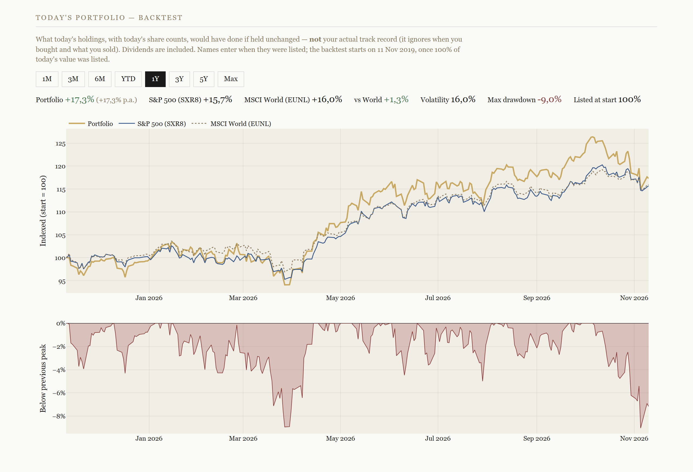
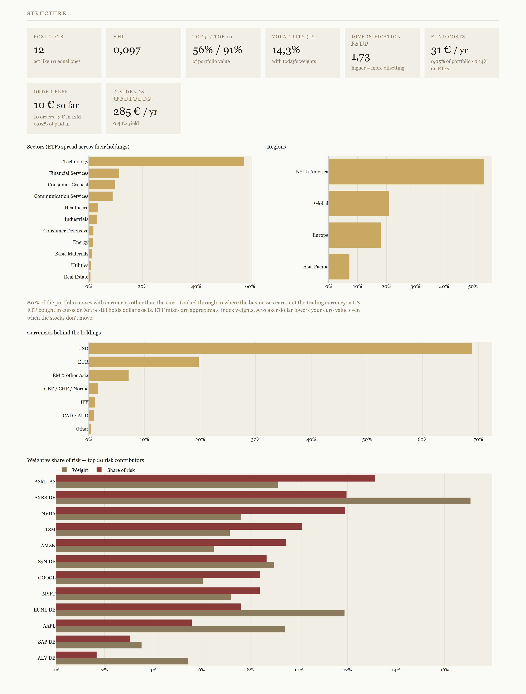
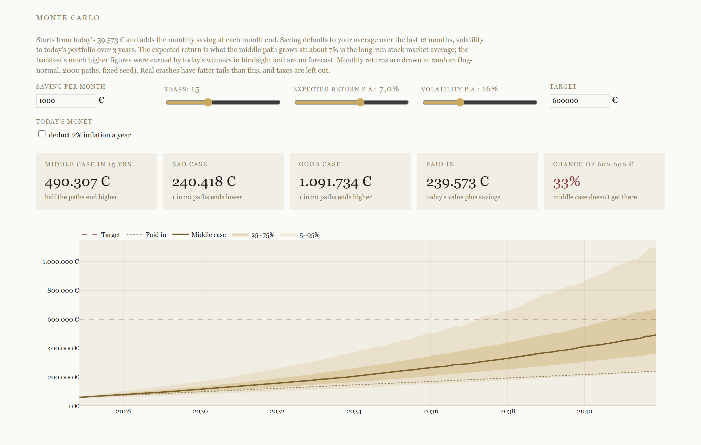

# Portfolio Email Agent

A fortnightly portfolio briefing in your inbox. Every other Saturday it values your holdings in EUR, compares them with the S&P 500, Nasdaq and MSCI World, picks the news that matters for what you own, and has Claude write the analysis and three to five concrete suggestions. An optional local dashboard goes deeper on the same data.

Built with Python · Claude API · yfinance · NewsAPI · Plotly · GitHub Actions · pytest

<p align="center">
  
</p>

<sub>All screenshots come from a made-up demo portfolio (`docs/demo/`) priced with real market data. No real holdings are shown.</sub>

---

## What you get

**The email** (every other Saturday, the main product)
- Masthead with value, the fortnight's change, weekly / monthly / YTD returns of today's holdings, your total return, and a split of the value change into *money paid in* vs *market gain*
- A one-line headline and a risk panel: Sharpe, Sortino, beta, alpha, max drawdown, VaR, volatility, concentration
- Positions table, a deposit-free portfolio index against the S&P 500, allocation, sector and region charts, top and bottom movers
- **The Analysis** by Claude: performance, benchmark comparison, and what the news means for *this* portfolio
- **Actionable**: 3–5 suggestions (ADD / TRIM / EXIT / RESEARCH), aware of what it recommended before
- Allocation vs your targets, upcoming earnings and ex-dividend dates, and a track record of earlier recommendations

**The dashboard** (optional, local, prices only, no Claude)
- Your actual record: paid in vs value, money-weighted return, the same deposits in an MSCI World ETF
- A backtest of today's holdings, risk and rolling metrics, look-through structure, stress tests, what-if, Monte Carlo, and the hit rate of every recommendation

**Behind both:** a daily snapshot after the New York close builds a price history that deposits can't distort.

---

## Screenshots

### Email

<table>
  <tr>
    <td width="50%"><br><sub>Deposit-free portfolio index vs the S&P 500 in EUR</sub></td>
    <td width="50%"><br><sub>Suggestions that refer back to earlier calls, plus target drift</sub></td>
  </tr>
</table>

<details>
<summary>The Analysis section</summary>

</details>

### Dashboard

<table>
  <tr>
    <td width="50%"><br><sub>Your actual record vs the same deposits in ETFs</sub></td>
    <td width="50%"><br><sub>Backtest of today's holdings</sub></td>
  </tr>
  <tr>
    <td width="50%"><br><sub>Structure, look-through exposure, risk share</sub></td>
    <td width="50%"><br><sub>Monte Carlo savings projection</sub></td>
  </tr>
</table>

---

## Quick start

```bash
pip install -r requirements.txt
cp .env.example .env                                  # add your API keys (step 2)
cp data/portfolio.csv.example data/portfolio.csv      # your holdings (step 4)
python agent.py --force --preview                     # writes output/preview.html, sends nothing
```

Open `output/preview.html` in a browser. When it looks right, set up Gmail (step 2) and the GitHub Actions schedule (step 6).

> **Heads up:** this was built for personal use and may need some adapting:
> - It is built around **EUR as the base currency**
> - The import scripts expect a **Finanzfluss** export; other brokers need different column names, or a hand-kept `portfolio.csv`
> - **ISIN → ticker overrides** live in `data/isin_map.json` (gitignored). Most ISINs resolve automatically via OpenFIGI; copy `data/isin_map.json.example` only if you need corrections

---

## Setup

### Prerequisites

- Python 3.11 or newer
- A Gmail account with 2-Step Verification enabled
- API keys for Anthropic and NewsAPI (free tier is enough)

### 1 — Install dependencies

```bash
pip install -r requirements.txt
```

### 2 — Get your API keys

**Anthropic:** [console.anthropic.com](https://console.anthropic.com) → **API Keys** → **Create Key**.

**NewsAPI:** sign up at [newsapi.org/register](https://newsapi.org/register) and copy the key from the dashboard.

**Gmail App Password:** Gmail needs an App Password for SMTP when 2-Step Verification is on.
1. [Google Account](https://myaccount.google.com) → **Security** → **2-Step Verification** (turn it on if needed)
2. At the bottom: **App passwords** → name it "Portfolio Agent"
3. Copy the 16-character password

### 3 — Configure your secrets

```bash
cp .env.example .env
```

```
ANTHROPIC_API_KEY=sk-ant-...
NEWS_API_KEY=abc123...
GMAIL_ADDRESS=you@gmail.com
GMAIL_APP_PASSWORD=xxxx xxxx xxxx xxxx
RECIPIENT_EMAIL=you@gmail.com
```

`.env` is gitignored. Never commit it. Set `CLAUDE_MODEL` to override the default model.

### 4 — Set up your portfolio

> **Finanzfluss user?** Skip this and use the [import script](#7--update-your-holdings-finanzfluss-users). It writes `data/portfolio.csv` for you.

All personal files live in `data/` (gitignored except the `*.example` templates); logs and previews go to `output/`.

```
ticker,name,shares,avg_buy_price
AAPL,Apple,10,150.00
NVDA,Nvidia,5,480.00
```

- `ticker`: Yahoo Finance symbol (`AAPL`, `SXR8.DE`, `BTC-USD`)
- `name`: readable name, also used for news searches
- `shares`: quantity held
- `avg_buy_price`: average purchase price **in EUR**

### 5 — Test it

```bash
python agent.py --force --preview   # build output/preview.html, no email, nothing saved
python agent.py --force             # send a real email now
```

`--force` skips the fortnight schedule check. Problems end up in `output/agent.log`.

### 6 — Schedule it

#### GitHub Actions (recommended)

Runs in the cloud; your data stays in a separate private repo.

1. Create a **private** repo (e.g. `portfolio-agent-data`) and upload your holdings: `finanzfluss_export.csv` (converted on every run) or a hand-kept `portfolio.csv`. Add `isin_map.json`, `targets.json` and `cashflows.csv` if you use them. `history.csv`, `conviction.json` and `recommendations.csv` are created by the first run
2. Create a fine-grained Personal Access Token for that repo with **Contents: Read and write**
3. In this repo, under **Settings → Secrets and variables → Actions**, add:
   - `DATA_REPO_TOKEN`: the token from step 2
   - `ANTHROPIC_API_KEY`, `NEWS_API_KEY`, `GMAIL_ADDRESS`, `GMAIL_APP_PASSWORD`, `RECIPIENT_EMAIL`
   - optional: `OPENFIGI_API_KEY`
4. Set the Actions **variable** `PORTFOLIO_DATA_REPO=owner/name` to point at your data repo (e.g. `owner/portfolio-agent-data`)

Two workflows then run on their own:

| Workflow | When | What |
|---|---|---|
| `snapshot.yml` | Mon–Fri 22:30 UTC | One `history.csv` row per trading day (prices only: no Claude, no email) |
| `report.yml` | Saturdays 06:00 UTC | Fills Friday's row if the snapshot missed it; sends the full email on every other Saturday |

Both push `history.csv`, `conviction.json` and `recommendations.csv` back to the private repo and share a concurrency group, so they never push at the same time. For a test email: **Actions → Portfolio Report → Run workflow → Force full report**.

#### Mac / Linux (cron)

```cron
# full report; the script itself checks for a send Saturday
0 8 * * 6     cd /path/to/portfolio-email-agent && /usr/bin/python3 agent.py >> output/agent.log 2>&1
# daily data point after the New York close
30 22 * * 1-5 cd /path/to/portfolio-email-agent && /usr/bin/python3 agent.py --data-only >> output/agent.log 2>&1
```

### 7 — Update your holdings (Finanzfluss users)

1. Finanzfluss → **Portfolio** → **Depot** → **Export**, save as `data/finanzfluss_export.csv`
2. Run:

```bash
python import_portfolio.py --input data/finanzfluss_export.csv
```

ISINs are resolved in this order: your `data/isin_map.json` overrides → [OpenFIGI](https://www.openfigi.com) (free bulk API) → yfinance search (slow fallback). The override file is only a correction layer: for ISINs OpenFIGI can't resolve, or ETFs where it picks the wrong listing (London instead of Xetra). Certificates and warrants are skipped, as are positions with zero shares.

```bash
cp data/isin_map.json.example data/isin_map.json   # only if you need overrides
```

> OpenFIGI allows 25 requests/min without a key and 250/min with a free one (`OPENFIGI_API_KEY` in `.env`). This only matters with a few hundred holdings.

### 8 — Target allocation (optional)

```bash
cp data/targets.json.example data/targets.json
# edit groups, target_pct and tickers (Yahoo tickers as in portfolio.csv)
```

The email then shows each group's drift. Groups more than `tolerance_pct` points off are highlighted and passed to Claude for the suggestions. Holdings in no group appear as *Unassigned*.

### 9 — Paid in vs market gain (optional)

Export your account transactions from Finanzfluss as `data/finanzfluss_transactions.csv`, then:

```bash
python import_cashflows.py --input data/finanzfluss_transactions.csv
```

This writes `data/cashflows.csv`, which holds only daily totals: money invested (buys minus sells), dividends and interest, and the number of one-off orders. Private spending, counterparties and transfers are dropped. Upload `cashflows.csv` (never the raw export) to the private data repo.

With it, the masthead splits the value change into paid in vs market, and shows a **Total** return: today's value minus everything ever paid in, including realised gains of sold positions. This assumes every purchase ran through that one account. Holdings moved in from another broker would count as gains.

### 10 — Interactive dashboard (optional)

```bash
python dashboard.py --open
```

This writes `output/dashboard.html`, a single file that loads Plotly from a CDN. It fetches prices only and takes about half a minute.

- **Your actual record**: paid in vs value, total gain, money-weighted return p.a. (XIRR) and the same deposits in the MSCI World or S&P 500, from `cashflows.csv` and `history.csv`. Put caveats about your own data in an optional `data/dashboard_note.txt`; they're shown under the tiles
- **Backtest of today's portfolio**: today's share counts held unchanged over up to 7 years against the iShares Core S&P 500 and MSCI World ETFs on Xetra, with drawdown, returns by period, monthly heatmap, risk table and rolling metrics. It shows how your current holdings behave, not your past performance
- **Positions**: return, contribution, volatility, beta, risk share and momentum per holding
- **Structure**: concentration, diversification ratio, fund costs, order fees, dividends, look-through sectors, regions and currencies, weight vs risk share, correlation heatmap
- **Simulations**: stress tests (Covid 2020, 2022 rates, 2024 yen carry, 2025 tariffs), a what-if re-weighting tool and a Monte Carlo projection
- **Recommendation track record**: every call in `recommendations.csv` against the MSCI World since the day it was made, with hit rates per action

The file contains your holdings and euro amounts. Keep it local, or host it only behind a login.

---

## How it works

```
data/portfolio.csv ─┐
data/cashflows.csv ─┤
                    ▼
yfinance ──→ prices, weekly/monthly/YTD changes, benchmarks; everything in EUR via daily FX
         ──→ earnings and ex-dividend dates for the next 14 days
NewsAPI  ──→ articles → Claude Haiku relevance filter → portfolio news + world digest
                    │
                    ▼
Claude (claude-sonnet-5 by default)
  ├── Portfolio performance
  ├── Benchmark comparison
  ├── News & market context
  └── Actionable suggestions ──→ recommendations.csv / conviction.json
                    │
                    ▼
HTML email ──→ Gmail SMTP ──→ your inbox
```

- **Deposit-free history.** Each `history.csv` row chains the EUR price return of your current holdings since the previous trading day. Money paid in or taken out never shows up as performance. The chart appears once four indexed rows exist.
- **Recommendation memory.** Each report reads the latest advice per name (`conviction.json`) so Claude can follow up on earlier calls, and the email's track record checks whether each call moved the right way. Every call is also appended to `recommendations.csv`; the dashboard scores those against the MSCI World.
- **Warnings.** A banner under the masthead flags a holdings or cash-flow export older than 30 days, and holdings whose ISIN couldn't be mapped.

### What stays private

| Where | What |
|---|---|
| This (public) repo | Code, `*.example` templates and the synthetic demo in `docs/demo/` |
| Private data repo | Holdings export, `history.csv`, `conviction.json`, `recommendations.csv`, `cashflows.csv`, `isin_map.json`, `targets.json` |
| Your machine only | `.env`, the raw transactions export, `output/` (log, preview, dashboard) |

---

## Demo data and screenshots

`PORTFOLIO_DATA_DIR` and `PORTFOLIO_OUTPUT_DIR` point the agent at other folders. The README screenshots are rebuilt from the demo portfolio like this:

```bash
python tools/make_demo_data.py                     # regenerate docs/demo/ from current prices
export PORTFOLIO_DATA_DIR=docs/demo PORTFOLIO_OUTPUT_DIR=output/demo
python agent.py --force --preview                  # one Claude call, nothing sent or saved
python dashboard.py
python tools/readme_screenshots.py                 # needs: pip install playwright && playwright install chromium
```

---

## Project layout

| Path | Purpose |
|---|---|
| `agent.py` | CLI: schedule check, orchestration, Gmail send |
| `market.py` | Portfolio load, FX, prices, history, charts, send cadence |
| `metrics.py` | Sharpe, beta, momentum, look-through exposure |
| `news.py` | NewsAPI and relevance filter |
| `claude_report.py` | Claude analysis, headline, recommendation memory |
| `email_html.py`, `theme.py` | HTML email and shared colours |
| `dashboard.py`, `analytics.py`, `templates/dashboard.html` | Interactive dashboard |
| `import_portfolio.py`, `import_cashflows.py` | Finanzfluss imports |
| `tools/` | Demo data and screenshot scripts |
| `tests/` | `python -m pytest` |

## Troubleshooting

| Problem | Fix |
|---|---|
| `data/portfolio.csv does not exist` | Run from the project directory |
| `No price history returned` | Check the ticker on [finance.yahoo.com](https://finance.yahoo.com) |
| Gmail authentication error | Re-create the App Password; 2-Step Verification must be on |
| NewsAPI returns no articles | The free tier has query limits; try simpler company names |
| Claude API error | Check `ANTHROPIC_API_KEY` and your credit balance |
| History chart missing | It needs four indexed rows in `history.csv`, i.e. four trading days of snapshots |

All runs are logged to `output/agent.log`.
